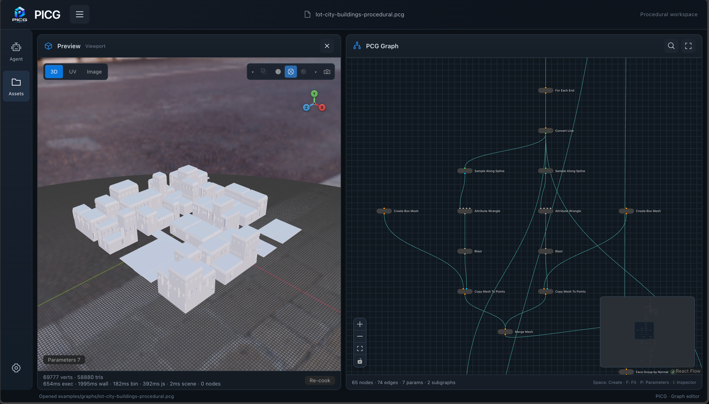
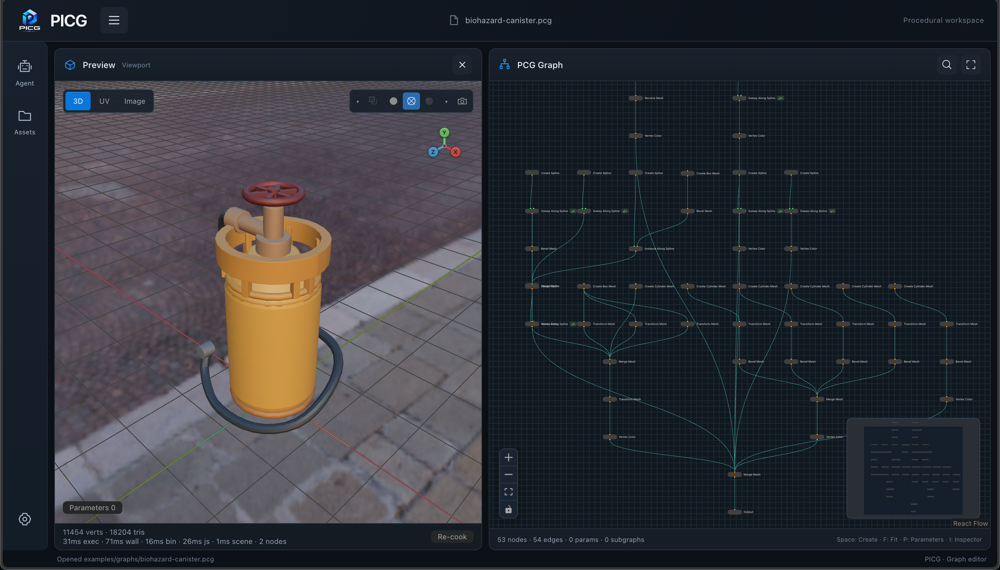
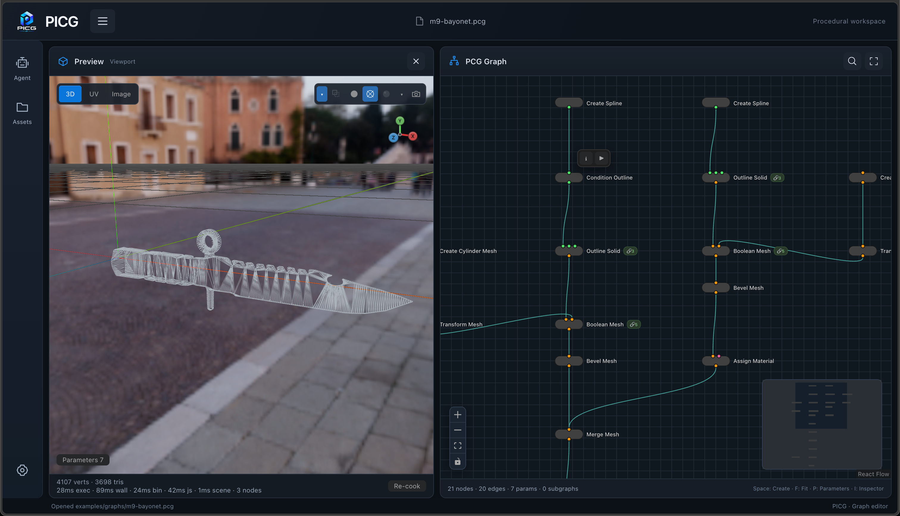
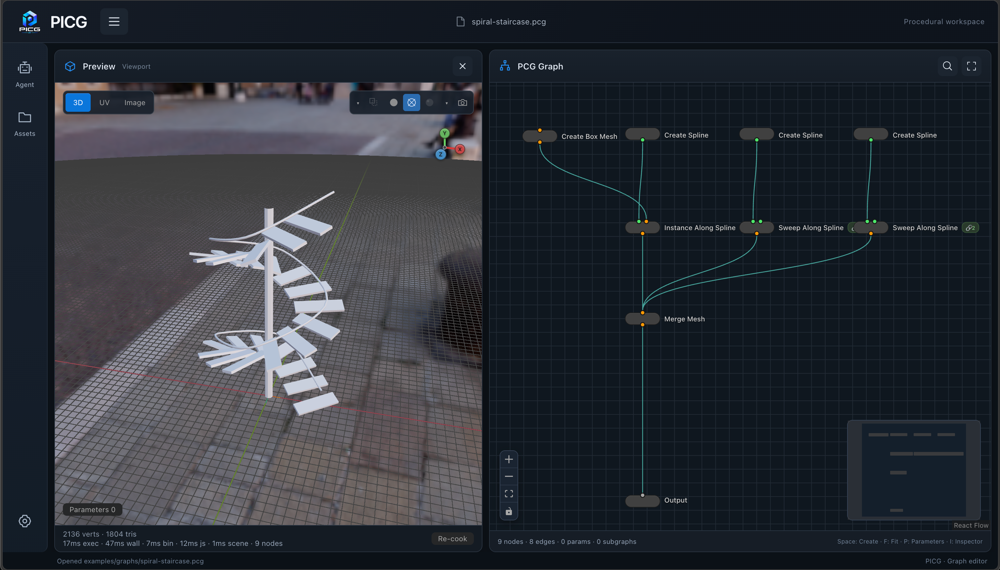
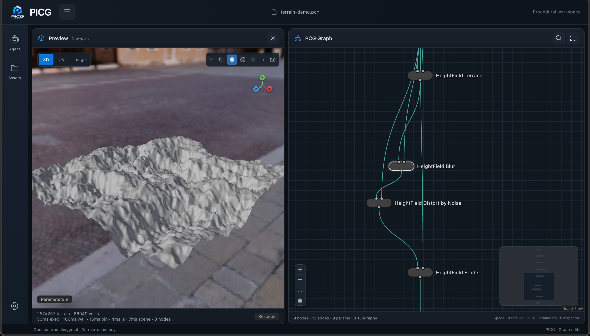
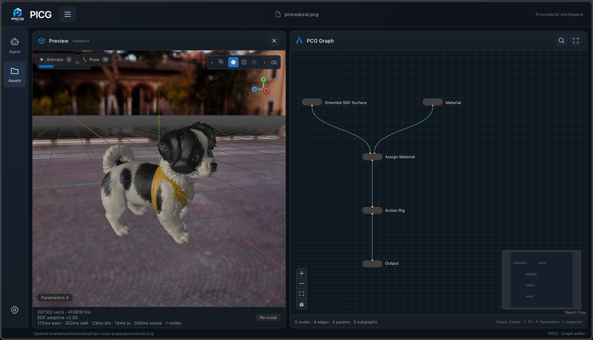
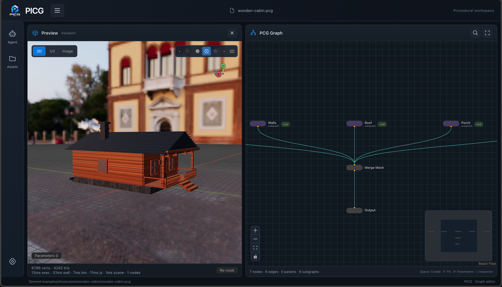

<p align="right">
  <a href="README.md">English</a> | <strong>简体中文</strong> | <a href="README.ja.md">日本語</a>
</p>

<h3 align="center"><a href="https://dj-huang.github.io/PCG-AI/">访问 PICG 官网</a></h3>

<p align="center">
  <a href="docs/index.html">官网页面源码</a>
</p>

<p align="center">
  
</p>

<h1 align="center">PICG</h1>

<p align="center">
  <strong>用一份可编辑的程序化图，从参考图走到可在引擎中使用的资产。</strong>
</p>

<p align="center">
  支持在 Web 编辑器中制作可复用资产，也支持通过 MCP 让外部 AI 客户端编辑同一张图。<br>
  目前已接入 Unity；Unreal Engine、Blender、Godot 和独立 Three.js 运行时仍在规划中。
</p>

<p align="center">
  <a href="LICENSE"></a>
  
  
  
</p>

PICG（Procedural Intelligent Content Generation）以 `.pcg` 文件作为资产的可移植源文件。你可以手动搭建节点图、让外部 AI 客户端通过 MCP 搭建，也可以用 Meshy 或 Tripo 从参考图起步。最终保留的不只是模型，还有可修改、可复现、可重新计算的生成流程。

> **项目状态：** 项目仍在积极开发。Web 编辑器与 Unity 集成可从源码运行；下文其他平台属于规划。稳定版发布前，图谱格式和 API 仍可能变化。

## 示例展示

下列截图左侧是 Web 编辑器的实时预览，旁边是可编辑的节点图。点击示例名可查看原始 `.pcg`，而非只能查看一张烘焙好的效果图。

| 示例 | 预览 | 展示内容 |
| --- | --- | --- |
| [城市建筑组](examples/graphs/lot-city-buildings-procedural.pcg) |  | 从地块和道路出发，复用装配逻辑生成建筑群。 |
| [生化储罐](examples/graphs/biohazard-canister.pcg) |  | 用样条曲线、基础几何体、倒角、变换和合并构建硬表面模型。 |
| [M9 刺刀](examples/graphs/m9-bayonet.pcg) |  | 从轮廓生成实体，再进行布尔切割、倒角、UV 和材质分配。 |
| [螺旋楼梯](examples/graphs/spiral-staircase.pcg) |  | 沿样条曲线扫掠并布置实例。 |
| [地形示例](examples/graphs/terrain-demo.pcg) |  | 高度场台阶化、模糊、噪声扭曲和侵蚀。 |
| [Tripo YoYo 小狗](examples/showcases/tripo-yoyo-puppy/procedural.pcg) |  | 从 Tripo 辅助生成的参考模型出发，继续处理表面、材质、语义部件和动作绑定。 |
| [木屋](examples/showcases/wooden-cabin/wooden-cabin.pcg) |  | 将可复用的墙体、屋顶和门廊子图组装成建筑。 |

更多节点图、测试用例和案例见 [examples/](examples/README.md)。

## 一份节点图，面向多个平台

PICG 将图谱数据约定和 C++ 执行语义与宿主编辑器、渲染器、场景对象及运行时绑定分开。目标是把资产的生成逻辑保留在一份 `.pcg` 文件中，由不同宿主接入，而不用为每个平台重写一遍。

| 平台 | 状态 | 功能或集成方向 |
| --- | --- | --- |
| **Web 编辑器** | **可用** | 可视化编辑节点、Three.js 实时预览、截图检查、Tripo 生成、导出 GLB。 |
| **Unity** | **可用** | 图编辑器、Scene 视图工作流、FBX/GLB 输出、材质、样条曲线、Terrain、GPU 实例化及运行时组件。 |
| **Unreal Engine** | **规划中** | 基于同一图谱格式和宿主数据约定的原生编辑器与场景集成。 |
| **Blender** | **规划中** | DCC 创作、程序化迭代与数据交换。 |
| **Godot** | **规划中** | 面向共享图谱格式的编辑器与运行时适配。 |
| **独立 Three.js 运行时** | **规划中** | 独立可复用的运行时包；当前 Web 编辑器已经用 Three.js 做预览，两者不是一回事。 |

宿主专用的绑定不写进可移植节点图。Unity 材质、未来的 Unreal 材质或特定场景的地形引用可以不同；生成逻辑、参数、随机种子和几何处理步骤仍可共用。

## 从参考图到引擎资产

```text
参考图 / 提示词 / 设计说明
    ├─ 在编辑器中手动搭建
    ├─ 由外部 AI 客户端通过 MCP 编辑
    └─ 用 Meshy / Tripo 辅助生成
                    ↓
           可编辑的 .pcg 节点图
    几何 · UV · 材质 · 层级 · 参数 · 种子
             绑定与运行时元数据
                    ↓
          校验 → Cook → 预览检查
              ↙             ↘
       Web / 导出 GLB      引擎编辑器与运行时集成
```

目标是形成能交付给引擎的资产工作流：可复现的几何、可用的材质和 UV、清楚的部件结构，并按资产需要附带绑定、动画、碰撞体或宿主绑定数据。生成结果是起点，仍可检查、修整、校验，并从图里重新计算。

## AI 直接编辑你正在看的节点图

### 通过 MCP 编辑

`pcg-server` 提供 Streamable HTTP MCP 端点 `http://127.0.0.1:17890/mcp`。Codex、Cursor、OpenCode 等支持相应配置的外部 MCP 客户端可检查当前编辑器，通过节点清单查询定义，创建节点、连线、改参数、校验、执行 Cook、截图并保存。

AI 操作的是你在编辑器里看到的同一张图。图哈希锁、原子操作、校验和预览截图方便核对每轮改动。AI 账号与模型在外部客户端配置；PICG Web 的 Settings 中配置的是 3D 生成服务。

```json
{
  "mcpServers": {
    "picg": {
      "url": "http://127.0.0.1:17890/mcp"
    }
  }
}
```

工具和完整编辑流程见[外部 MCP 客户端](docs/pcg-server.md#external-mcp-clients)。

### 用 Meshy 和 Tripo 辅助生成

- **Meshy：** Unity 集成中的节点支持图生 3D、文生 3D、重拓扑、缩放、UV 展开、重贴图和图像生成。
- **Tripo：** Web 和 Unity 均支持图生 3D。Web 编辑器中，在 **Settings → 3D Generation** 配置 API 密钥，然后在 `Tripo3DGenerator` 节点中手动发起生成并缓存 GLB。之后可手动调整节点图，也可让外部 MCP 客户端继续处理。
- 云端请求需要显式发起，结果可缓存。普通 Cook、预览和编辑使用本地已有结果，不会默默消耗 API 点数。
- 密钥保留在本机受保护的存储或引擎偏好设置中，不写入 `.pcg` 文件。

这些服务适合用来起草模型、重建参考、辅助拓扑和材质处理；可复跑的节点图、下游处理、校验和引擎交付由 PICG 组织。见[第三方图生 3D](docs/third-party-image-to-3d.md)。

## Unity 原生集成与运行时边界

引擎集成不止是导出文件。宿主适配层可将场景数据作为图的输入，也能把 Cook 结果应用回引擎中的原生对象。

Unity 已包含节点图资产、Inspector、Scene 视图预览、材质绑定、样条曲线输入、Terrain 读写、GPU 实例化散布，以及在 Player 里执行节点图的 `PcgRuntimeRunner`。**当前 Unity Player 需要在同一台机器上另外运行 `pcg-server`，还不是无需外部进程的独立运行时。** 具体部署边界见 [Unity 运行时](docs/Tutorials/07-unity-runtime.md)。

规划中的 Unreal Engine、Blender、Godot 和 Three.js 集成将复用版本化图谱和原生执行核心，并分别处理宿主的场景绑定、材质、资产导入和运行时生命周期。

## 核心能力

- **可移植图谱：** `.pcg` 可编辑、可版本管理、可对比变更，供创作工具和宿主集成共用。
- **原生程序化核心：** C++17 负责几何和节点图执行，用明确的参数和随机种子复现结果。
- **资产构建节点：** 基础几何体、样条、散布、地形/高度场、布尔、倒角、材质、子图、导入、装配和绑定元数据。
- **Web 创作与检查：** React Flow 图编辑、Three.js 预览、诊断截图、动画控制及 GLB 导出。
- **Unity 集成：** 编辑器和运行时组件使用同一图谱约定，并通过外部原生服务执行 Cook。
- **MCP 自动化：** 外部客户端可通过本地服务操作正在编辑的图及预览视口。
- **参考辅助创作：** 可用图片和 Meshy/Tripo 节点接入程序化资产制作流程。

## 快速上手

### 环境要求

- Node.js `^20.19.0` 或 `>=22.12.0`
- CMake 3.20 或更新版本
- 支持 C++17 的编译器
- 若 CMake 未自动获取 libcurl，需提供 libcurl 开发文件
- 可选：使用仓库的 Unity 项目时，准备 Unity 2022.3 或团结引擎（Unity 1.6.x）

克隆仓库并初始化子模块：

```bash
git clone --recurse-submodules https://github.com/DJ-Huang/PCG-AI.git
cd PCG-AI
```

### macOS / Linux

同时启动本地服务和 Web 编辑器：

```bash
./scripts/run-pcg-web.sh
```

脚本会构建缺失的原生产物、安装缺失的 Web 依赖并启动：

- Web 编辑器：`http://127.0.0.1:5173`
- 服务健康检查：`http://127.0.0.1:17890/v1/health`
- MCP 端点：`http://127.0.0.1:17890/mcp`

### Windows PowerShell

在仓库根目录打开第一个终端，启动服务并保持运行：

```powershell
.\scripts\build-pcg-server.ps1 -Run
```

再开一个 PowerShell，从同一仓库根目录启动编辑器：

```powershell
cd web\pcg-editor
npm ci
npm run dev
```

分开启动、导入第一个示例和配置 Unity 的步骤见[上手指南](docs/getting-started.md)。

## 架构

手动编辑与外部 MCP 客户端操作同一份版本化 `.pcg`。本地 `pcg-server` 提供 Cook、MCP、3D 生成、缓存与导出，调用 `pcg-core`（C++17）执行图并处理几何、点、样条、材质及元数据。Web/Three.js 负责预览和 GLB 导出；引擎宿主提供自己的编辑器与运行时绑定。

C++ 运行时定义图谱的执行行为；编辑器和引擎在这套执行语义之上提供创作及宿主接入。协议和组件边界见[架构文档](docs/architecture.md)。

## 仓库结构

```text
PCG-AI/
├── .agents/               外部客户端技能与程序化资产工作流
├── docs/                  上手、架构、运行时与集成文档
├── examples/              节点图、测试、子图、展示案例与分镜
├── library/               内置子图库的源文件
├── pcg-core/              C++ 图执行与几何算法
├── pcg-fbx-exporter/      独立 FBX 导出库
├── pcg-server/            本地 HTTP/MCP Cook、3D 生成、缓存与导出服务
├── schema/                版本化图谱格式和节点清单
├── scripts/               构建、启动、同步和校验脚本
├── Unity/                 Unity 编辑器与运行时集成
└── web/pcg-editor/        Vite + React 节点图编辑器和 Three.js 视口
```

## 构建与校验

```bash
# 构建原生核心并运行测试
./scripts/build-pcg-core.sh --run-tests

# 校验仓库约定
python3 scripts/validate-manifest.py
python3 scripts/validate-subgraph-schema.py
python3 scripts/validate-builtin-library.py
python3 scripts/check-doc-language.py

# 服务冒烟测试（需先运行 pcg-server）
./scripts/verify-pcg-server.sh
```

```bash
# Web 编辑器
cd web/pcg-editor
npm ci
npm run lint
npm run build
npx vitest run
```

完整命令见[脚本目录](scripts/README.md)。

## 文档

- [上手指南](docs/getting-started.md)
- [架构](docs/architecture.md)
- [PCG 服务、3D 生成与 MCP](docs/pcg-server.md)
- [第三方图生 3D](docs/third-party-image-to-3d.md)
- [节点参考](docs/node-reference.md)
- [Unity 项目](Unity/README.md)
- [子图库](library/README.md)
- [路线图](ROADMAP.md)
- [变更记录](CHANGELOG.md)
- [维护流程](docs/maintainer-workflows.md)

## 贡献与安全

提交 PR 前请读[贡献指南](CONTRIBUTING.md)，报告漏洞前请读[安全政策](SECURITY.md)。社区约定、项目治理和支持范围分别见[行为准则](CODE_OF_CONDUCT.md)、[治理文档](GOVERNANCE.md)和[支持说明](SUPPORT.md)。

## 许可证

PICG 采用 [Apache License 2.0](LICENSE)。
